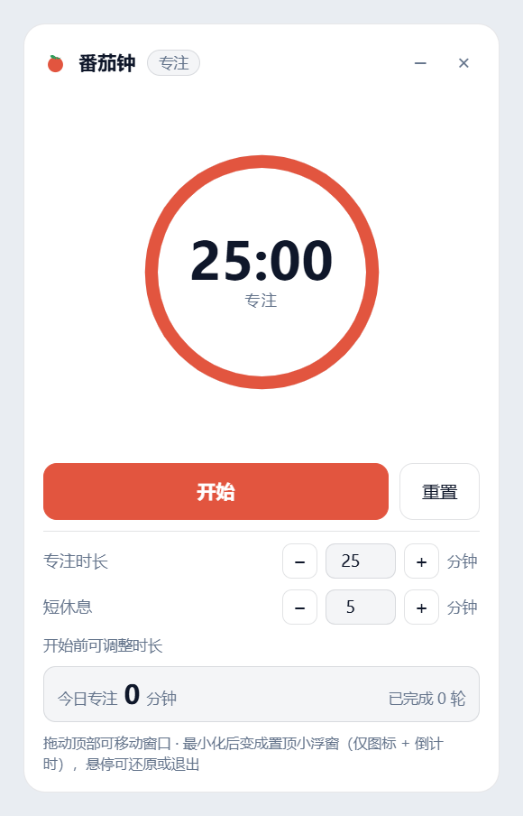
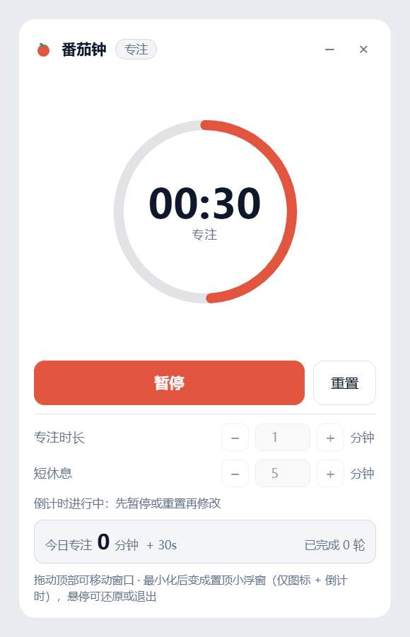
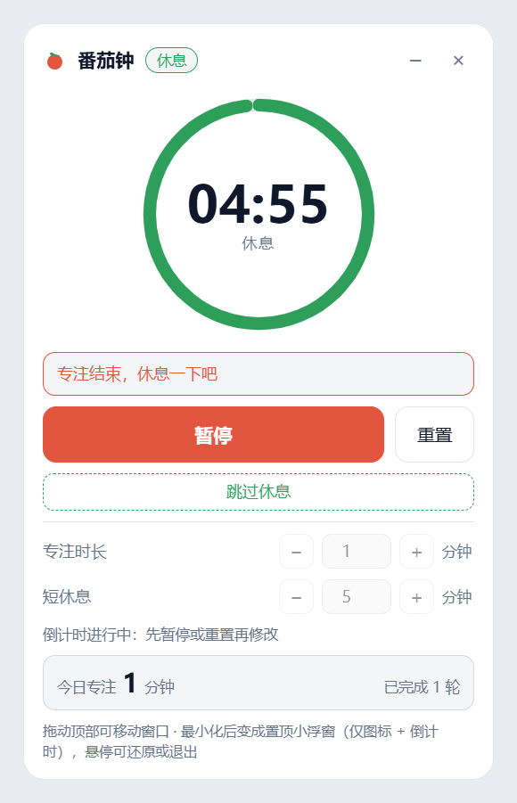
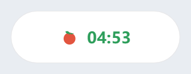

<p align="center">
  
</p>

<h1 align="center">PomatoTimer</h1>

<p align="center">
  A movable, always-on-top Pomodoro timer for Windows.<br />
  Collapse it into a tiny pill that shows only the tomato and the countdown.
</p>

<p align="center">
  <b>English</b> · <a href="README.zh-CN.md">简体中文</a>
</p>

<p align="center">
  <a href="https://github.com/essldd/PomatoTimer-desktop/releases/latest">
    <b>⬇ Download for Windows (.exe)</b>
  </a><br />
  <sub>Portable — no installer, no Node.js needed · Windows 10/11 x64</sub>
</p>

<p align="center">
  
</p>

## Features

- **Movable floating panel** — drag the title bar anywhere; the position and window shape are remembered.
- **Always-on-top mini pill** — press `–` or `Esc`: the window shrinks to 188×58, stays above other windows, stays out of the taskbar, and shows only the tomato icon and the countdown.
- **25-minute focus / 5-minute break**, both adjustable (1–180 / 1–120), with start, pause and reset.
- **Automatic transitions** — when a focus ends it says "专注结束，休息一下吧" and starts the break; skip the break if you like, and it tells you when the break is over.
- **Today's focus time** accrues live and is saved to a local JSON file. Resetting mid-session still credits the time actually spent.
- **Light/dark** follows Windows; fully offline, no account, no telemetry.

| Focus running | Break starts by itself |
| :---: | :---: |
|  |  |

<p align="center">
  <br />
  <sub>Mini pill — hover it to restore or quit.</sub>
</p>

## Download & install

### Option 1 — Portable exe (recommended)

1. Open the [latest release](https://github.com/essldd/PomatoTimer-desktop/releases/latest).
2. Download `PomatoTimer-<version>-portable.exe`.
3. Double-click it. Nothing to install, no Node.js needed.

Settings and the window position are stored in a `data` folder next to the exe.

### Option 2 — Run from source

**Requirements:** Windows 10/11, [Node.js](https://nodejs.org/) 18 or newer.

```bash
git clone https://github.com/essldd/PomatoTimer-desktop.git
cd PomatoTimer-desktop
npm install
npm start
```

The first `npm install` downloads Electron (about 100 MB).

Start minimized as the always-on-top pill:

```bash
npm run start:mini
```

**Optional — desktop shortcut with the tomato icon:**

```bat
create-shortcut.cmd
```

Or simply double-click `start.cmd` (it reuses `node_modules` when present).

### Build the exe yourself

```bash
npm run dist
```

The portable executable is written to `release\`.

## Usage

| Action | How |
| --- | --- |
| Move the window | Drag the title bar |
| Start / pause | `Space`, or the big button |
| Reset | The 重置 button |
| Minimize to the always-on-top pill | `–`, or `Esc` |
| Restore / quit from the pill | Hover it, then `⤢` / `×` (double-click also restores) |
| Adjust focus / break length | Before starting — the inputs lock while a countdown runs |

Settings and today's total are stored in `data/settings.json` (created on first run).

The interface is in Simplified Chinese.

## Notes

**该 Windows 桌面端使用 DeepSeek Harness 制作。**

This Windows desktop app was built with [DeepSeek Harness](https://github.com/deepseek-ai/deepseek-harness).

## License

[MIT](LICENSE)
