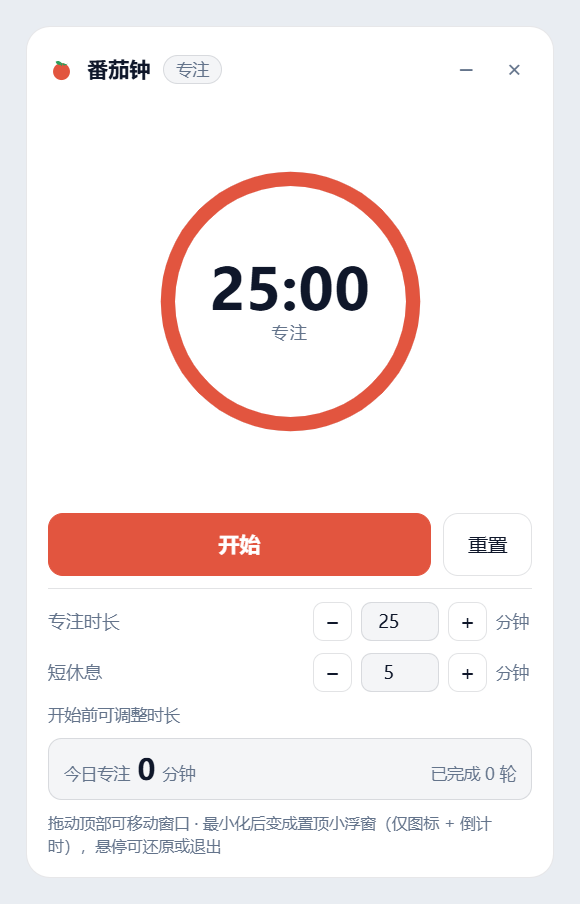
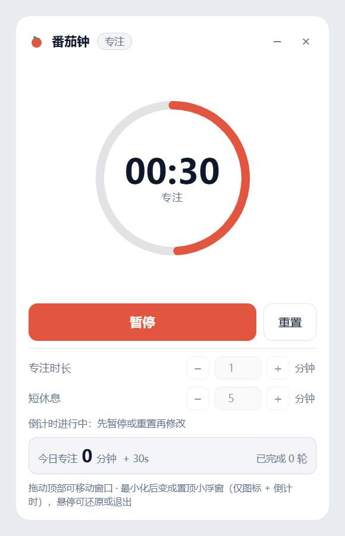
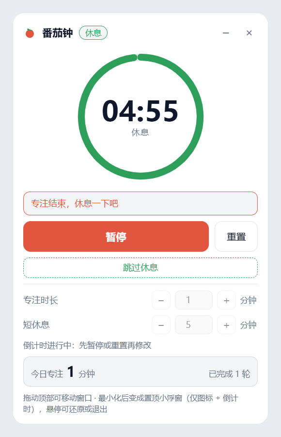
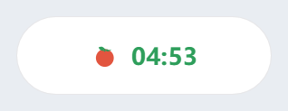

<p align="center">
  
</p>

<h1 align="center">PomatoTimer · 番茄钟桌面端</h1>

<p align="center">
  Windows 上可随意拖动、始终置顶的番茄钟。<br />
  还能收成一个小胶囊，只显示番茄图标和倒计时。
</p>

<p align="center">
  <a href="README.md">English</a> · <b>简体中文</b>
</p>

<p align="center">
  <a href="https://github.com/essldd/PomatoTimer-desktop/releases/latest">
    <b>⬇ 下载 Windows 版（.exe）</b>
  </a><br />
  <sub>便携版 —— 免安装、无需 Node.js · Windows 10/11 x64</sub>
</p>

<p align="center">
  
</p>

## 功能

- **可拖动的浮窗**：按住标题栏拖到任意位置，窗口位置与形态自动记住。
- **始终置顶的迷你浮窗**：点「–」或按 `Esc`，窗口缩成 188×58，压在其它窗口之上、不进任务栏，只显示番茄图标与倒计时。
- **专注 25 分钟 / 短休息 5 分钟**，都可调（1–180 / 1–120），支持开始、暂停、重置。
- **自动切换**：专注结束提示「专注结束，休息一下吧」并自动开始休息，可「跳过休息」；休息结束提示「休息结束，继续专注吧」。
- **今日专注时长**实时累计并写入本地 JSON；中途重置也会计入已度过的时间。
- **深浅色**跟随系统；纯离线，无需账号，无遥测。

| 专注进行中 | 到点自动进入休息 |
| :---: | :---: |
|  |  |

<p align="center">
  <br />
  <sub>迷你浮窗 —— 鼠标悬停可还原或退出。</sub>
</p>

## 下载与安装

### 方式一：便携版 exe（推荐）

1. 打开 [最新 Release](https://github.com/essldd/PomatoTimer-desktop/releases/latest)。
2. 下载 `PomatoTimer-<版本>-portable.exe`。
3. 双击运行。免安装，也不需要 Node.js。

设置与窗口位置保存在 exe 同级的 `data` 目录里。

### 方式二：从源码运行

**环境要求：** Windows 10/11，[Node.js](https://nodejs.org/) 18 或更高版本。

```bash
git clone https://github.com/essldd/PomatoTimer-desktop.git
cd PomatoTimer-desktop
npm install
npm start
```

首次 `npm install` 会下载 Electron（约 100 MB）。

直接以置顶小胶囊启动：

```bash
npm run start:mini
```

**可选 —— 创建带番茄图标的桌面快捷方式：**

```bat
create-shortcut.cmd
```

也可以直接双击 `start.cmd`（存在 `node_modules` 时会自动使用它）。

### 自行打包 exe

```bash
npm run dist
```

便携版 exe 会生成在 `release\` 目录。

## 使用说明

| 操作 | 方式 |
| --- | --- |
| 移动窗口 | 拖动标题栏 |
| 开始 / 暂停 | `Space` 或大按钮 |
| 重置 | 「重置」按钮 |
| 收成置顶小胶囊 | 「–」或 `Esc` |
| 从胶囊还原 / 退出 | 鼠标悬停胶囊，点 `⤢` / `×`（双击也可还原） |
| 调整时长 | 开始之前；倒计时进行中输入框会锁定 |

设置与今日专注保存在 `data/settings.json`（首次运行自动创建）。

界面语言为简体中文。

## 说明

**该 Windows 桌面端使用 DeepSeek Harness 制作。**

This Windows desktop app was built with [DeepSeek Harness](https://github.com/deepseek-ai/deepseek-harness).

## 许可协议

[MIT](LICENSE)
